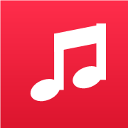

# iMusic

<div align="center">



### A Native Music Player for iOS 12 & iPhone 6
**The Authentic Apple Music Experience Powered by YouTube Music**

[](https://github.com/sanjibxdas/iMusic/actions/workflows/build.yml)
[](https://en.wikipedia.org/wiki/IOS_12)
[-000000.svg?style=flat-square&logo=apple)](https://en.wikipedia.org/wiki/IPhone_6)
[](https://en.wikipedia.org/wiki/ARM_architecture_family)
[](LICENSE)

</div>

---

## Overview

**iMusic** is a lightweight, high-performance native iOS music player engineered specifically for legacy devices such as the **iPhone 6 running iOS 12.5.8**.

While modern streaming applications require iOS 15, 16, or later, iMusic brings the contemporary YouTube Music streaming catalog into the classic, iconic **Apple Music iOS 12 interface** — built in pure Swift 5 and UIKit without modern framework bloat.

---

## Features

- **Apple Music iOS 12 Design**:
  - **Library**: Playlists, Artists, Albums, Songs, Favorites, and Recently Added history.
  - **For You**: Curated heavy rotation cards, favorites mix, and editorial playlists.
  - **Browse**: Featured editorial playlists and Top Global Charts.
  - **Radio**: Apple Music 1 live radio tile alongside genre radio stations.
  - **Search**: Fast song & artist search with category filter chips (Songs, Artists, Albums, Playlists) and trending suggestions.
- **Floating Mini-Player**:
  - Docked above the bottom tab bar with live progress indicator, track details, and instant transport controls.
  - Tap or swipe up to expand seamlessly into the Full Now Playing modal.
- **Full Now Playing Screen**:
  - High-resolution album artwork with Apple's iconic playback scaling animation (artwork gently scales down on pause and expands on play).
  - Smooth scrolling marquee labels (`MarqueeLabel`) for long track titles.
  - Scrubbing slider with real-time elapsed/remaining countdowns and volume control.
  - Center state switcher: toggle instantly between **Album Artwork**, **Synchronized Scrolling Lyrics**, and the **Up Next Queue**.
  - Shuffle, Repeat (Off, All, One), AirPlay route picker, and Favorites button.
- **Synchronized Lyrics**:
  - Real-time, line-by-line synchronized lyrics powered by **LRCLIB**.
  - Auto-scrolling lyrics with tap-to-seek functionality.
- **Audio Streaming Engine**:
  - Multi-tier stream resolution for YouTube Music with local proxy streaming to prevent Google Video 403 Forbidden IP-locking errors.
  - Direct hardware-accelerated `m4a` (AAC) playback via `AVPlayer`.
- **Background Playback & Lock-Screen Controls**:
  - Full `AVAudioSession` background playback (`.playback` category).
  - Complete `MPNowPlayingInfoCenter` and `MPRemoteCommandCenter` integration (Lock Screen, Control Center, headphone controls, and Apple Watch).
- **Engineered for iPhone 6 (1 GB RAM Budget)**:
  - Zero heavy third-party dependencies (no CocoaPods, SPM bloat, or Electron/WebViews).
  - Strict 20 MB `NSCache` memory threshold with automated eviction on memory pressure warnings to prevent iOS Jetsam kills.
  - Custom CoreGraphics vector glyphs (`IconFactory`) that render crisply on Retina `@2x` displays without needing iOS 13+ SF Symbols.
  - Storyboard-based launch screen eliminating the iOS 12 letterboxing hazard.

---

## Installation

Every commit to `main` automatically compiles and packages two production distribution formats via GitHub Actions:
- **`iMusic.ipa`** (for Sideloadly, 3uTools, or Filza with AppSync Unified)
- **`iMusic.deb`** (for Sileo, Zebra, and Cydia package managers)

### Option 1: Sileo / Zebra / Filza (`.deb`) — *Recommended for Jailbroken Devices*
1. Download `iMusic.deb` from the latest [GitHub Actions Workflow Run](https://github.com/sanjibxdas/iMusic/actions).
2. Transfer `iMusic.deb` to your iPhone 6 (via AirDrop, Filza WebDAV/SMB, or SSH into `/var/mobile/Documents/`).
3. Open **Filza**, navigate to `iMusic.deb`, and tap **Install**.
4. Once completed, tap **Respring** (or run `uicache`). **iMusic** will appear on your Home Screen.

### Option 2: Filza with AppSync Unified (`.ipa`)
1. Ensure **AppSync Unified** is installed from `cydia.akemi.ai`.
2. Transfer `iMusic.ipa` to your device and tap **Install** directly inside Filza.

### Option 3: Sideloadly / AltStore / 3uTools (`.ipa`)
1. Connect your iPhone 6 to your computer via USB.
2. Open Sideloadly or 3uTools, select `iMusic.ipa`, and click **Start**.

---

## Architecture & Project Structure

```
iMusic/
├── .github/workflows/
│   └── build.yml               # Xcode 15.4 macOS-14 automated CI build pipeline
├── iMusic/
│   ├── App/
│   │   ├── AppDelegate.swift   # Classic iOS 12 UIWindow lifecycle
│   │   └── AppTheme.swift      # Apple Music dark palette & typography
│   ├── Base.lproj/
│   │   └── LaunchScreen.storyboard # Prevents SpringBoard letterboxing
│   ├── Models/
│   │   ├── Track.swift         # Core track model
│   │   ├── MediaModels.swift   # Artist, Album, Playlist models
│   │   └── Lyrics.swift        # LRC timestamp parser & document model
│   ├── Services/
│   │   ├── StreamResolver.swift# Invidious & Innertube stream resolution
│   │   ├── MusicAPIService.swift # YouTube Music search & browse parser
│   │   ├── LyricsService.swift # LRCLIB synchronized lyrics API
│   │   ├── ImageLoader.swift   # Memory-capped NSCache image loader
│   │   └── StorageManager.swift# JSON persistence for favorites & history
│   ├── Playback/
│   │   ├── AudioPlayer.swift   # AVPlayer queue & background manager
│   │   └── NowPlayingCenter.swift # Lock screen & MPRemoteCommandCenter
│   ├── UI/
│   │   ├── Common/             # IconFactory, MarqueeLabel, TrackCell, etc.
│   │   ├── Navigation/         # MainTabBarController & RootContainer
│   │   ├── MiniPlayer/         # Floating translucent mini player
│   │   ├── NowPlaying/         # Full player modal, lyrics, & queue views
│   │   ├── Library/            # User library & playlists
│   │   ├── ForYou/             # Curated mixes & heavy rotation
│   │   ├── Browse/             # Top charts & featured sections
│   │   ├── Radio/              # Beats 1 / Apple Music 1 & genre stations
│   │   └── Search/             # Search controller & filter chips
│   ├── Assets.xcassets/        # AppIcon asset catalog
│   └── Info.plist
└── iMusic.xcodeproj/           # Xcode project targeting iOS 12.0 (arm64)
```

---

## Building Locally

To build from source on a Mac:
```bash
# Select Xcode 15.4 (last Xcode supporting iOS 12 deployment)
sudo xcode-select -s /Applications/Xcode_15.4.app

# Compile unsigned archive
xcodebuild \
  -project "iMusic.xcodeproj" \
  -scheme "iMusic" \
  -configuration Release \
  -sdk iphoneos \
  -archivePath "build/iMusic.xcarchive" \
  -destination "generic/platform=iOS" \
  ARCHS=arm64 \
  ONLY_ACTIVE_ARCH=NO \
  IPHONEOS_DEPLOYMENT_TARGET=12.0 \
  CODE_SIGNING_ALLOWED=NO \
  CODE_SIGNING_REQUIRED=NO \
  archive
```

---

## License

This project is licensed under the [MIT License](LICENSE).
